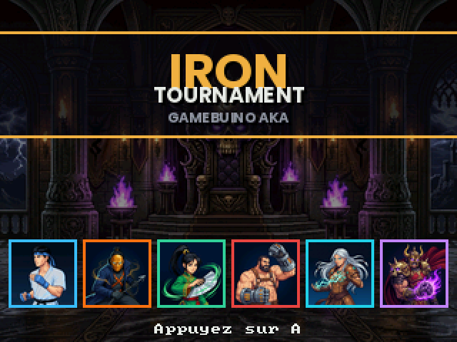
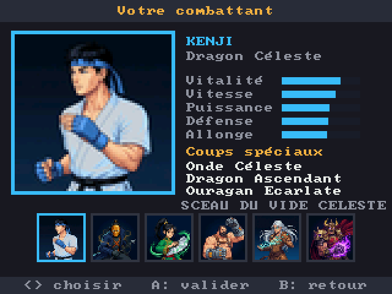
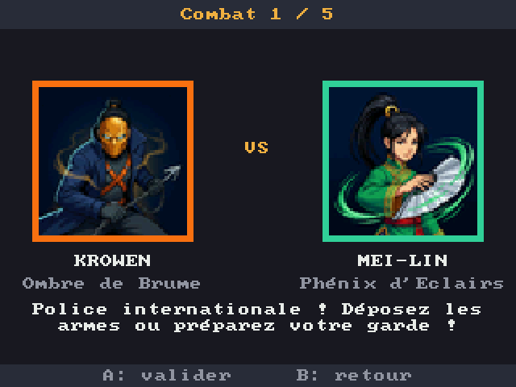
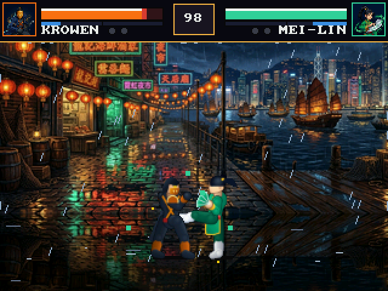

# Iron Tournament

Jeu de combat 1 contre 1 : six maîtres, un tournoi en cinq combats, un tyran au bout. Existe en **prototype web** (ce dépôt, racine)
et en version native pour la console **Gamebuino AKA** (ESP32-S3), avec une **version PC** (Windows et Linux).

| | |
|---|---|
|  |  |
|  |  |

*(captures réelles de la version PC, générées par le test d'intégration `--autotest`)*

## Jouer en 30 secondes
1. Télécharge la dernière version dans les [Releases](../../releases) : `IronTournament-PC-windows-*.zip` ou `IronTournament-PC-linux-*.tar.gz` (SD de la console : `IronTournament-AKA-SD-*.zip`).
2. Décompresse, lance `irontournament`.
3. **Entrée** pour valider, puis choisis **Tournoi**. Clavier : flèches ou WASD, **J** poing, **K** pied, **L** spécial. Manette reconnue.
4. Niveau **Novice** pour découvrir (l'IA t'aide quand tu perds une manche), **Arcade** pour un vrai combat, **Maître** pour les habitués.

## Ce qu'il y a dedans
- **Six combattants** aux styles distincts (Kenji, Krowen, Mei-Lin, Titan, Nyxia, Malakor), chacun avec son décor animé, ses trois spéciaux, son SUPER et sa fin.
- Un **univers** : citation d'entrée de chaque adversaire, répliques de victoire, et une fin racontée pour chaque combattant qui gagne le tournoi.
- Un moteur de baston complet : tampon d'entrée, annulation en spécial, enchaînement léger → lourd, jauge de Ki, EX, SUPER, garde, parade punitive contre le spam, riposte.
- **2 joueurs en réseau** (câble USB ou Wi-Fi), duels libres, revanche immédiate, liste des coups en pause.
- 5 langues : français, anglais, allemand, espagnol, italien.

## Pour aller plus loin
Tout le détail technique, l'équilibrage mesuré, les tests et ce qui n'est pas encore vérifié : **[aka/README.md](aka/README.md)**.
Le prototype web se lance avec `npm install && npm run dev` (Vite / TypeScript).
